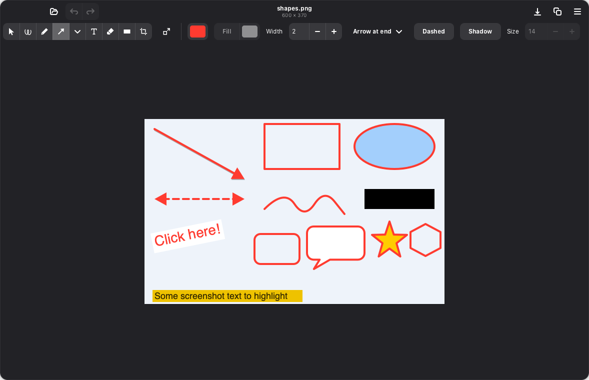

# Scrawl

Image viewer and markup tool for Linux, modelled on the Markup toolbar in
macOS Preview. Open an image or paste a screenshot, add arrows, shapes, text,
highlights and redactions, then save it or copy it back to the clipboard.

Built with Rust, GTK 4 and libadwaita.



## Features

- **Sketch:** draw a rough line, box or circle in one stroke and it snaps to
  a clean shape. If you wanted the hand-drawn version, click
  **Keep Drawing**.
- **Draw:** smoothed freehand strokes.
- **Shapes:** line, arrow (heads at start, end or both), rectangle, rounded
  rectangle, oval, speech bubble, star and hexagon.
- **Text:** text boxes with font size, background fill and rotation.
- **Highlight and Redact:** a marker-style highlight, and black boxes that
  are burned into the pixels when you save.
- **Styling:** color, fill, line width, dashed lines and drop shadows.
- **Editing:** move, resize and duplicate annotations, bring to front or
  send to back, and undo/redo.
- **Crop:** stays adjustable until you save.
- **Adjust Size:** Fit into presets, pixels, per cent, inches, cm, mm or
  points, plus resolution, scale proportionally and resample. The resolution
  is kept in PNG and JPEG metadata.
- **Clipboard:** paste a screenshot to start (Ctrl+V), and copy the annotated
  result back (Ctrl+C).
- **Opening files:** drag and drop, or Open With from your file manager.
- **Saving:** your original file is never overwritten by accident. The first
  save asks where to put the annotated copy.

## Install from source

You need GTK ≥ 4.14, libadwaita ≥ 1.5 and Rust ≥ 1.83. That means Ubuntu
24.04, Fedora 40, Debian 13 or newer, or any rolling-release distro.

### 1. System libraries

```sh
# Debian / Ubuntu / Pop!_OS
sudo apt install build-essential pkg-config libgtk-4-dev libadwaita-1-dev

# Fedora
sudo dnf install gcc pkgconf-pkg-config gtk4-devel libadwaita-devel

# Arch
sudo pacman -S base-devel gtk4 libadwaita
```

### 2. Rust

Use [rustup](https://rustup.rs). The `rustc` packaged by Ubuntu and Debian
is usually too old.

```sh
curl --proto '=https' --tlsv1.2 -sSf https://sh.rustup.rs | sh
```

### 3. Build and install

```sh
git clone https://github.com/mozartdiniz/scrawl.git
cd scrawl
cargo install --path . --root ~/.local
install -Dm644 data/io.github.mozartdiniz.Scrawl.desktop -t ~/.local/share/applications/
install -Dm644 data/io.github.mozartdiniz.Scrawl.metainfo.xml -t ~/.local/share/metainfo/
install -Dm644 data/icons/hicolor/scalable/apps/io.github.mozartdiniz.Scrawl.svg -t ~/.local/share/icons/hicolor/scalable/apps/
```

If you have [just](https://github.com/casey/just), `just install` does all of
step 3 after cloning, and `just uninstall` removes it again.

Scrawl now shows up in your app grid and in **Open With** for images. You can
also start it from a terminal (make sure `~/.local/bin` is on your `PATH`):

```sh
scrawl screenshot.png
```

### Flatpak

A manifest is included. Flatpak builds run offline, so generate the cargo
sources first with
[flatpak-cargo-generator](https://github.com/flatpak/flatpak-builder-tools/tree/master/cargo):

```sh
python3 flatpak-cargo-generator.py Cargo.lock -o cargo-sources.json
flatpak-builder --user --install --force-clean build-flatpak io.github.mozartdiniz.Scrawl.yaml
```

## Keyboard shortcuts

| Keys | Action |
|---|---|
| V S P | Select, Sketch, Draw |
| A L R O | Arrow, Line, Rectangle, Oval (more in the Shapes ▾ palette) |
| T H X C | Text, Highlight, Redact, Crop |
| Shift + drag | Square boxes, 45° lines |
| Enter | Apply the crop, or edit the selected text |
| Double-click text | Edit it (Ctrl+Enter to finish) |
| Drag the knob above text, or `[` `]` | Rotate text (Shift and the keys snap to 15°) |
| Delete, arrow keys | Delete or nudge the selection (Shift: 10 px) |
| Ctrl+Z, Ctrl+Shift+Z | Undo, redo |
| Ctrl+K | Crop to the selection |
| Ctrl+D, Ctrl+Shift+F, Ctrl+Shift+B | Duplicate, bring to front, send to back |
| Ctrl+C, Ctrl+V | Copy the annotated image, new image from the clipboard |
| Ctrl+S, Ctrl+Shift+S | Save, save as |
| Ctrl+scroll, Ctrl+0, Ctrl+1 | Zoom, fit to window, actual size |

## Development

```sh
cargo run -- some-image.png   # run from the source tree
cargo test                    # controller, renderer, sketch recognition, I/O
```

Icons are compiled into the binary by `build.rs`, so `cargo run` works
without installing anything. It also runs on macOS with Homebrew's `gtk4`
and `libadwaita`, which is handy for development.

To check the renderer visually, write a sample with every annotation type
to a PNG:

```sh
SCRAWL_RENDER_OUT=/tmp/sample.png cargo test flatten
```

Two documents explain the design:

- [`CLAUDE.md`](CLAUDE.md): the architecture, in brief.
- [`PREVIEW_RESEARCH.md`](PREVIEW_RESEARCH.md): what macOS Preview's
  shipped binary shows about how its Markup feature is built, and how
  Scrawl maps onto it.

## License

[MIT](LICENSE)
